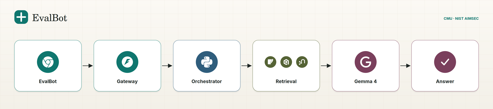

# EvalBot front end

Dependency-free chat UI for a healthcare-AI evaluation assistant.

## Run
```bash
python3 -m http.server 8000
# open http://localhost:8000
```

## Connect your back end
Runs in demo mode with canned answers. To go live, set the endpoint before `app.js` loads (e.g. in `index.html`):

```html
<script>window.EVALBOT_CONFIG = { API_URL: "https://your-host/api/chat" };</script>
```

Request: `POST { messages: [{role: "user"|"assistant", text}], context: {system, stage, region, focus: []} }`

Response (JSON):
```json
{
  "text": "markdown string (## headings, lists, **bold**, > quotes supported)",
  "checklist": { "title": "...", "groups": [{ "name": "...", "items": ["..."] }] },
  "citations": [
    { "type": "arxiv|pubmed|web", "title": "...", "authors": "...", "venue": "...", "year": 2023,
      "arxiv": "2307.15343", "pmid": "31649194", "doi": "...", "url": "...", "claim": "what the answer uses it for" }
  ]
}
```
`checklist` and `citations` are optional. Put `[1]`, `[2]` markers in `text`; they link to `citations[0]`, `citations[1]`, … in the right-hand Sources panel, which builds arXiv / PubMed / DOI links from the identifiers. Edit `window.sendMessage` in `api.js` if you need streaming or auth.

---

# Backend — event-driven microservices

The front end above talks to a Python backend that grounds answers in the extracted
scoping-review corpus (15,954 papers) and streams tokens from an open-weights
**Gemma 4 26B-A4B** endpoint (OpenRouter by default, swappable).

Nothing in the request path reads the spreadsheet: the `.xlsx` is a **one-time build
input**, converted offline into `data/papers.jsonl` + `data/papers.db` (+ a Qdrant index
and optionally a Neo4j graph).

📐 **Diagram:** [Architecture diagram](#architecture-diagram) — one-question flow plus the full nine-service map.

🎬 **Demo video:** [`demo/evalbot-demo.mp4`](demo/evalbot-demo.mp4) — 20 s, captured from the live stack (streaming answer, citation panel, SQL aggregate). Open [`demo/preview.html`](demo/preview.html) to play it locally; rebuild with `python scripts/build_demo_video.py <shots…>`.

## Topology

```
browser ──SSE──► gateway :8080 ──chat.requested──► bus ──► orchestrator :8081
                                                             │ route intent
                        ┌────────────────────┬───────────────┴───────────┐
                        ▼                    ▼                           ▼
                 sqlite-service        vector-service             graph-service
                    :8082                  :8083                      :8084
              (SQL/FTS5/aggregates)   (Qdrant ANN)              (Cypher templates
                                                                 or SQLite fallback)
                        └─────────── retrieval.completed ─────────────────┘
                                             ▼
                                      llm-service :8085 ── llm.token* ──► bus
                                             ▼
                                      answer-service :8086 (citation guard, renumber, sanitize)
                                             ▼ answer.completed
              gateway relays SSE: meta → delta* → done
      event-log :8087 (audit + replay)   control-plane :8090 (model registry, hot swap)
```

| Intent (rule router) | Route | Example |
|---|---|---|
| `aggregate` | **SQLite only** — exact SQL counts, never the model's arithmetic | "how many oncology papers report external validation?" |
| `faceted` | SQLite filters + FTS5 BM25 | "sepsis papers since 2020 with external validation" |
| `semantic` | Qdrant dense ANN | "how do models predict deterioration from nursing notes" |
| `multihop` | Neo4j template (or the SQLite graph fallback) | "papers by the same authors as …" |
| `hybrid` (default) | BM25 + dense + 1-hop graph expansion → RRF (k=60) | anything else |

Every service is independently runnable (`python -m services.<name>.main`), and
`MONOLITH=1` runs all of them in one process over an in-memory bus with the identical
events — same code, so tests and local dev do not need Redis, Neo4j or a GPU.

## Architecture diagram

<picture>
  <source media="(prefers-color-scheme: dark)" srcset="architecture/evalbot-architecture-dark.svg">
  <source media="(prefers-color-scheme: light)" srcset="architecture/evalbot-architecture.svg">
  
</picture>

<sub>HTML version, both themes: <a href="architecture/evalbot-architecture.html">evalbot-architecture.html</a>
· full service map: <a href="architecture/evalbot-architecture-detail.png">detail view</a></sub>

| file | what |
|---|---|
| `architecture/evalbot-architecture.{svg,png}` | **simple view**, light — six stops, brand logos (3456×768 PNG) |
| `architecture/evalbot-architecture-dark.{svg,png}` | same view, dark theme (GitHub picks it automatically) |
| `architecture/evalbot-architecture.html` | standalone responsive page, both themes, no build step |
| `architecture/evalbot-architecture-detail.{svg,png,html}` | **detail view** — every service, port and event (3360×3040) |
| `architecture/logos/` | brand marks (Simple Icons, white paths) inlined into the SVG at build time |
| `architecture/logo.svg` | EvalBot mark and wordmark |

```bash
python3 architecture/build_diagram.py     # both diagrams: svg -> html + png + checks
```

The build fails rather than shipping a broken image: every label is measured with the real
system fonts against the box that holds it, labels that collide are rejected, the simple
view is not allowed to grow the per-service detail, and each logo badge's colour is sampled
back out of the finished PNG.

## Quickstart (single process, no GPU)

```bash
uv venv .venv --python 3.12 && uv pip install -r requirements.txt
cp .env.example .env                      # then set OPENROUTER_API_KEY

python -m ingest.ingest --xlsx final_merged_dataset.xlsx     # one-off: xlsx -> data/papers.jsonl
python -m ingest.sqlite_build                                # data/papers.jsonl -> data/papers.db
python -m ingest.qdrant_index --limit 500                    # optional dense index (hash embedder works offline)
python -m ingest.verify                                      # cross-store consistency table

set -a; . ./.env; set +a
MONOLITH=1 python -m services.monolith.app                   # http://localhost:8080
python3 -m http.server 8000                                 # UI on :8000, already wired to :8080
```

`LLM_PROVIDER=mock` answers offline from retrieved evidence, so the whole pipeline is
testable without a key or a GPU. Switch `LLM_PROVIDER=openrouter` for real generation.

## Streaming

`POST /api/chat/stream` returns `text/event-stream`:

| frame | payload | when |
|---|---|---|
| `meta` | `{route, evidence_count, sources[], degraded[]}` | right after retrieval — the Sources panel can render before the first token |
| `delta` | `{text}` | per token batch (~24 chars / 40 ms) |
| `done` | `{text, checklist, citations[], markers, usage, model, profile, route}` | final |
| `error` | `{message, partial}` | failure; partial text is kept, never wiped |

`POST /api/chat` is the same flow without SSE (tests, curl, non-streaming clients).
Citations come from the retrieved records, not from the model, so `[n]` markers are
renumbered and out-of-evidence sources are dropped by `answer-service`.

## Changing models (no restart)

Profiles live in `models.yaml` (`chat`, `judge`, `embed`). Hot swap:

```bash
curl -X POST localhost:8090/api/admin/profiles/chat \
  -H "Authorization: Bearer $ADMIN_TOKEN" -H 'Content-Type: application/json' \
  -d '{"model":"google/gemma-4-12b-it"}'
```

That writes the registry, publishes `model.changed`, and `llm-service` re-resolves the
model (verifying the slug against the provider's `/models`) without a restart. A failed
verification keeps the previous profile. `GET /api/admin/models` shows the active
profiles with context window and price per 1M tokens; per-request override via the
`X-Model-Profile` header.

## Configuration

All settings are environment variables — see `.env.example` for the full annotated list
(`OPENROUTER_API_KEY`, `LLM_PROVIDER`, `GEMMA_MODEL`, `MONOLITH`, `BUS`, `DB_PATH`,
`NUM_EVIDENCE`, `EMBED_PROVIDER`, `NEO4J_URI`, `ADMIN_TOKEN`, ports, timeouts).

## Tests

```bash
.venv/bin/python -m pytest -q          # offline: fixture DB, in-memory bus, mock provider
```

No test reads the dataset, hits the network, or needs Redis/Neo4j/a GPU.

## Notes and caveats

- **Model hardware**: 26B-A4B is a MoE (26B total / 4B active, ~51.6 GB bf16). OpenRouter
  hosts it, so no local GPU is required. Self-hosting needs ≥1×80 GB (or `TP=2` on 2×48 GB),
  or a quantised checkpoint. Gemma weights are open-weights under the **Gemma Terms of Use**,
  not an OSI licence.
- **Field trust**: the corpus columns are LLM extraction records, not ground truth. A
  40-paper verification pass found `confidence_intervals_reported` and dataset-size fields
  wrong ~70% of the time, `metrics_reported` ~30%, external validation ~15%. The answer
  prompt says so explicitly; treat counts as corpus statistics, not literature facts.
- **Dense leg = `google/embeddinggemma-2`** (768-d, `EMBED_PROVIDER=local`). Queries and
  documents get **asymmetric prompts** (`task: search result | query: …` vs
  `title: … | text: …`), because a shared prompt silently halves recall. One vector per
  paper (no chunking — the row is the retrieval unit and the citation is a PMID); the
  structured axes are prepended as a short facet sentence, and also live in the payload
  and FTS. Index dim ≠ model dim (e.g. after switching models) is detected and the vector
  leg degrades with a log line instead of returning garbage: rebuild with
  `python -m ingest.qdrant_index --recreate`. `EMBED_PROVIDER=hash` stays for offline tests.
- **Neo4j is local and optional.** `./scripts/neo4j_up.sh` starts `neo4j:5-community` in a
  standalone container (7474 / 7687, data in `data/neo4j`), with `--status` and `--stop`.
  `python -m ingest.neo4j_graph` loads the graph once `data/papers.jsonl` exists. If the
  container is not running, `graph-service` logs `neo4j.checked available=false` and
  evaluates the **same** named templates over SQLite — you only lose multi-hop traversal.
- **Ports**: the API defaults to `8080` because `8000` is used by the static UI server.
- **Regulatory questions** are answered from a small curated guidance file when present;
  the corpus is research papers, not legal advice.
